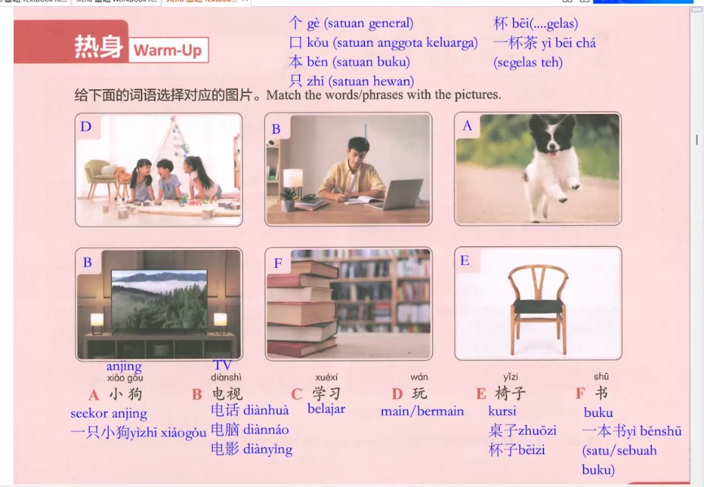

# 📘 Panduan Pengembangan & Standar Arsitektur (CLAUDE.md)
## Modul Pembelajaran Bahasa Mandarin (Buku Teks & Workbook)

Dokumen ini adalah pedoman baku dan spesifikasi arsitektur resmi untuk memelihara, memperluas, dan membuat halaman **Buku Teks (`BabN.html`)** serta **Buku Latihan (`WorkBookBabN.html`)** baru pada proyek Mandarin ini. Seluruh file yang dibuat di masa mendatang **WAJIB** mematuhi aturan, konvensi penamaan, struktur DOM, dan skema warna yang didefinisikan di sini.

---

## 📂 1. Arsitektur Proyek & Struktur Direktori

### 1.1 Lokasi Penyimpanan Ganda (Dual-Path Sync)
Proyek ini memiliki dua salinan direktori yang harus selalu **sinkron 100% byte-per-byte**:

| Salinan | Path | Deskripsi |
|---|---|---|
| **Lokal (Web Server)** | `C:\laragon\www\Power\Mandarin\` | Lingkungan pengembangan aktif di Laragon |
| **Git Repository** | `C:\laragon\www\Power\Mandarin\mandarin-kosakata\` | Folder repositori Git yang tersambung ke GitHub |

> [!CAUTION]
> Setiap pembuatan atau pengeditan file (`BabN.html`, `WorkBookBabN.html`, `Index.html`, gambar, dll.) **HARUS langsung disalin ke folder `mandarin-kosakata`**. Pastikan hasil salinan memiliki hash SHA-256 yang identik sebelum melakukan `git commit`.

### 1.2 Peta File Proyek
```text
C:\laragon\www\Power\Mandarin\
├── Index.html                  # Portal beranda utama (daftar bab & workbook)
├── Bab1.html - Bab9.html       # Modul buku teks percakapan (Bab 1 s.d. Bab 9)
├── WorkBookBab1.html - ...     # Modul workbook latihan (Master CSS: WorkBookBab1.html)
├── kosakata kelistrikan.html   # Modul kosakata khusus teknis
├── favicon.ico                 # Favicon portal
├── images/                     # Aset gambar pembelajaran & kelistrikan
├── CLAUDE.md                   # Dokumen pedoman ini
├── workbook.md                 # Ringkasan cepat spesifikasi workbook
└── mandarin-kosakata/          # Cermin repositori Git (mirror identik)
```

### 1.3 Aturan File Bersih (Clean Workspace)
- **DILARANG** meninggalkan file sementara atau skrip uji coba sekali pakai (seperti `analyze.js`, `download_*.js`, `temp.html`, `style2.css`, dll.) di root folder.
- File yang boleh berada di root hanyalah: `Index.html`, `BabN.html`, `WorkBookBabN.html`, `kosakata kelistrikan.html`, `favicon.ico`, `images/`, `CLAUDE.md`, `workbook.md`, dan folder git.

---

## 🎨 2. Standar Desain & Skema Warna

Setiap bab memiliki identitas warna tema (`--primary`) yang unik, dengan struktur CSS yang seragam.

### 2.1 Palet Warna Buku Teks (`BabN.html`)

| Bab | Tema Utama | `--primary` | `--primary-dark` | `--primary-soft` |
|:---:|---|:---:|:---:|:---:|
| **Bab 1** | Merah Kaisar | `#c0392b` | `#8e1a12` | `rgba(192, 57, 43, 0.08)` |
| **Bab 2** | Ungu Royal | `#8e44ad` | `#5b2c6f` | `rgba(142, 68, 173, 0.08)` |
| **Bab 3** | Biru Samudra | `#2980b9` | `#1a5276` | `rgba(41, 128, 185, 0.08)` |
| **Bab 4** | Hijau Emerald | `#059669` | `#047857` | `rgba(5, 150, 105, 0.08)` |
| **Bab 5** | Jingga / Amber | `#d35400` | `#a04000` | `rgba(211, 84, 0, 0.08)` |
| **Bab 6** | Biru Teal | `#2980b9` | `#1a5276` | `rgba(41, 128, 185, 0.08)` |
| **Bab 7** | Crimson / Rose | `#be123c` | `#881337` | `rgba(190, 18, 60, 0.08)` |
| **Bab 8** | Emerald Teal | `#0d9488` | `#0f766e` | `rgba(13, 148, 136, 0.08)` |
| **Bab 9** | Indigo Royal | `#4f46e5` | `#3730a3` | `rgba(79, 70, 229, 0.08)` |
| **Bab 10+** | Disarankan Sky/Amber/Rose | `#0284c7` / `#d97706` | Sesuai turunan | Sesuai turunan 0.08 |

### 2.2 Palet Warna Workbook (`WorkBookBabN.html`)

| Bab | `--primary` | `--primary-dark` | Header Gradient | Badge Header |
|:---:|:---:|:---:|:---:|:---:|
| **Bab 1** | `#c0392b` | `#8e1a12` | `#d35400 → #a04000` | `#f39c12` |
| **Bab 2** | `#7c3aed` | `#5b21b6` | `#6d28d9 → #4c1d95` | `#8b5cf6` |
| **Bab 3** | `#0369a1` | `#0c4a6e` | `#0284c7 → #075985` | `#38bdf8` |
| **Bab 4** | `#15803d` | `#14532d` | `#16a34a → #166534` | `#4ade80` |
| **Bab 5** | `#d35400` | `#a04000` | `#e67e22 → #d35400` | `#fbbf24` |
| **Bab 6** | `#2980b9` | `#1a5276` | `#2980b9 → #1a5276` | `#38bdf8` |
| **Bab 7** | `#be123c` | `#881337` | `#be123c → #881337` | `#fb7185` |
| **Bab 8** | `#4f46e5` | `#3730a3` | `#4f46e5 → #3730a3` | `#818cf8` |
| **Bab 9** | `#0d9488` | `#0f766e` | `#0d9488 → #0f766e` | `#2dd4bf` |

### 2.3 Variabel Global Baku (`:root`)
```css
:root {
  --primary: #...;        /* Warna aksen utama bab */
  --primary-dark: #...;   /* Varian gelap untuk border/gradient */
  --primary-soft: rgba(...); /* Varian transparan untuk background badge/card */
  --gold: #f39c12;
  --bg: #f4f6f9;
  --card-bg: #ffffff;
  --text: #2d3436;
  --sub: #636e72;
  --border: #e2e8f0;
  --radius: 16px;
  --shadow: 0 4px 20px rgba(0, 0, 0, 0.06);
}
```

---

## 🏛️ 3. Arsitektur Halaman Buku Teks (`BabN.html`)

Setiap file bab buku teks adalah dokumen mandiri (*self-contained*) dengan struktur standar berikut.

### 3.1 Kerangka Dasar & Header
```html
<!DOCTYPE html>
<html lang="id">
<head>
  <meta charset="UTF-8" />
  <meta name="viewport" content="width=device-width, initial-scale=1.0" />
  <title>Dialog Bahasa Mandarin - Bab N: [JUDUL_HANZI] ([JUDUL_PINYIN])</title>
  <link rel="icon" type="image/x-icon" href="favicon.ico" />
  <link rel="icon" type="image/svg+xml" href="data:image/svg+xml,<svg xmlns=%22http://www.w3.org/2000/svg%22 viewBox=%220 0 100 100%22><text y=%22.9em%22 font-size=%2290%22>🈶</text></svg>" />
  <style>
    /* Google Fonts Import */
    @import url('https://fonts.googleapis.com/css2?family=Noto+Sans+SC:wght@300;400;600;700&family=Poppins:wght@300;400;600;700&display=swap');
    
    /* CSS Variables & Global Resets */
    :root { ... }
    * { box-sizing: border-box; margin: 0; padding: 0; }
    body { font-family: 'Poppins', sans-serif; background: var(--bg); color: var(--text); padding-bottom: 75px; }
    
    /* Header, Nav, Wrap, Dialog, Classroom, Cards, Toolbar Styles */
    ...
  </style>
</head>
<body class="show-pinyin show-arti show-vocab">

<!-- HEADER RESMI -->
<header>
  <h1>🈶 Dialog Bahasa Mandarin</h1>
  <p>Latihan percakapan · 对话练习</p>
  <div class="bab">Bab N — [JUDUL_HANZI] ([JUDUL_PINYIN]) · [TERJEMAHAN_INDONESIA]</div>
  
  <!-- Tautan Cepat ke Workbook jika sudah tersedia -->
  <div style="margin-top:0.55rem;">
    <a href="WorkBookBabN.html" style="display:inline-flex;align-items:center;gap:0.35rem;background:rgba(255,255,255,0.22);color:#fff;text-decoration:none;padding:0.3rem 0.9rem;border-radius:20px;font-size:0.78rem;font-weight:600;border:1px solid rgba(255,255,255,0.4);transition:all 0.2s ease;">
      📝 Buka Workbook Bab N ([Deskripsi Materi]) →
    </a>
  </div>
</header>
```

> [!NOTE]
> **Standar CSS & Dimensi Tinggi Header Resmi (`header`) dari Bab 9**:
> Ketinggian dan proporsi header wajib mengikuti standar Bab 9 agar seragam di semua bab:
> ```css
>     /* ── HEADER RESMI (STANDAR BAB 9) ── */
>     header {
>       background: linear-gradient(135deg, var(--primary) 0%, var(--primary-dark) 100%);
>       color: #fff;
>       text-align: center;
>       padding: 2.5rem 1rem 2rem;
>       position: relative;
>       overflow: hidden;
>     }
>     header::before {
>       content: '对话';
>       position: absolute;
>       font-size: 11rem;
>       font-family: 'Noto Sans SC', sans-serif;
>       font-weight: 700;
>       color: rgba(255, 255, 255, 0.05);
>       top: 50%; left: 50%;
>       transform: translate(-50%, -50%);
>       pointer-events: none;
>       user-select: none;
>       line-height: 1;
>     }
>     header h1 {
>       font-size: 1.9rem;
>       font-weight: 700;
>       letter-spacing: -0.3px;
>       position: relative;
>     }
>     header p {
>       margin-top: 0.35rem;
>       font-size: 0.88rem;
>       opacity: 0.88;
>       position: relative;
>     }
>     header .bab {
>       display: inline-block;
>       background: var(--gold);
>       color: #fff;
>       border-radius: 20px;
>       padding: 0.2rem 0.95rem;
>       font-size: 0.8rem;
>       font-weight: 700;
>       margin-top: 0.65rem;
>       position: relative;
>       box-shadow: 0 2px 8px rgba(0, 0, 0, 0.15);
>     }
> ```
> Saat layar HP / mobile (`@media (max-width: 640px)`):
> ```css
>     header h1 { font-size: 1.4rem; }
> ```

### 3.2 Navigasi Sticky 3-Kolom Simetris (`.nav-bar`)
Bar navigasi menempel di bagian atas (`position: sticky; top: 0; z-index: 1000;`) dengan 3 slot simetris menggunakan CSS standar baku dari Bab 9:
- **Kiri**: Tombol Bab Sebelumnya (`.nav-pager-btn.prev`)
- **Tengah**: Tombol Navigasi Menu Utama (`.nav-home-btn`)
- **Kanan**: Tombol Bab Berikutnya (`.nav-pager-btn.next`)

#### Spesifikasi CSS Standar Baku Navbar (Baku Bab 9):
```css
    /* ── MODERN STICKY NAVBAR ── */
    .nav-bar {
      background: rgba(255, 255, 255, 0.95);
      backdrop-filter: blur(10px);
      -webkit-backdrop-filter: blur(10px);
      border-bottom: 1px solid var(--border);
      position: -webkit-sticky;
      position: sticky;
      top: 0;
      z-index: 1000;
      box-shadow: 0 2px 10px rgba(0, 0, 0, 0.03);
    }
    .nav {
      max-width: 860px;
      margin: 0 auto;
      padding: 0.65rem 1rem;
      display: grid !important;
      grid-template-columns: 1fr auto 1fr !important;
      align-items: center;
      gap: 0.6rem;
    }
    .nav-side-left {
      display: flex;
      justify-content: flex-start;
      align-items: center;
    }
    .nav-center {
      display: flex;
      justify-content: center;
      align-items: center;
    }
    .nav-side-right {
      display: flex;
      justify-content: flex-end;
      align-items: center;
    }
    .nav-home-btn {
      display: inline-flex;
      align-items: center;
      gap: 0.45rem;
      text-decoration: none;
      font-size: 0.82rem;
      font-weight: 600;
      color: #475569;
      background: #f1f5f9;
      padding: 0.45rem 0.85rem;
      border-radius: 10px;
      border: 1px solid var(--border);
      transition: all 0.2s ease;
    }
    .nav-home-btn:hover {
      background: #e2e8f0;
      color: #0f172a;
    }
    .nav-pager-btn {
      display: inline-flex;
      align-items: center;
      gap: 0.35rem;
      text-decoration: none;
      font-size: 0.82rem;
      font-weight: 600;
      padding: 0.45rem 0.95rem;
      border-radius: 10px;
      transition: all 0.2s ease;
    }
    .nav-pager-btn.next {
      background: var(--primary);
      color: #ffffff;
      box-shadow: 0 2px 8px rgba(0, 0, 0, 0.15);
    }
    .nav-pager-btn.next:hover {
      background: var(--primary-dark);
      transform: translateX(2px);
    }
    .nav-pager-btn.prev {
      background: #f1f5f9;
      color: #475569;
      border: 1px solid var(--border);
    }
    .nav-pager-btn.prev:hover {
      background: #e2e8f0;
      color: #0f172a;
      transform: translateX(-2px);
    }
```
```html
<nav class="nav-bar">
  <div class="nav">
    <div class="nav-side-left">
      <!-- Jika ada Bab sebelumnya -->
      <a href="Bab[N-1].html" class="nav-pager-btn prev" title="Kembali ke Bab [N-1]">
        <svg width="14" height="14" viewBox="0 0 24 24" fill="none" stroke="currentColor" stroke-width="2.5" stroke-linecap="round" stroke-linejoin="round"><polyline points="15 18 9 12 15 6"></polyline></svg>
        <span>Bab [N-1]</span>
      </a>
      <!-- Jika tidak ada (Bab 1), biarkan kosong: <div class="nav-side-left"></div> -->
    </div>
    
    <div class="nav-center">
      <a href="index.html" class="nav-home-btn" title="Kembali ke Daftar Bab">
        <svg width="15" height="15" viewBox="0 0 24 24" fill="none" stroke="currentColor" stroke-width="2.2" stroke-linecap="round" stroke-linejoin="round"><path d="M3 9l9-7 9 7v11a2 2 0 0 1-2 2H5a2 2 0 0 1-2-2z"></path><polyline points="9 22 9 12 15 12 15 22"></polyline></svg>
        <span class="label">Menu Utama</span>
      </a>
    </div>
    
    <div class="nav-side-right">
      <!-- Jika ada Bab selanjutnya -->
      <a href="Bab[N+1].html" class="nav-pager-btn next" title="Lanjut ke Bab [N+1]">
        <span>Bab [N+1]</span>
        <svg width="14" height="14" viewBox="0 0 24 24" fill="none" stroke="currentColor" stroke-width="2.5" stroke-linecap="round" stroke-linejoin="round"><polyline points="9 18 15 12 9 6"></polyline></svg>
      </a>
      <!-- Jika Bab terakhir, biarkan kosong: <div class="nav-side-right"></div> -->
    </div>
  </div>
</nav>
```

### 3.3 Container Konten (`<div class="wrap">`)
Semua konten pembelajaran diletakkan di dalam satu pembungkus utama berukuran maksimal 860px:
```html
### 3.3 Standar Ukuran, Jarak & Proporsi Komponen (Design Tokens)
Untuk menjamin konsistensi visual di seluruh bab, seluruh ukuran dimensi, tinggi, padding, margin, dan tipografi komponen wajib mengikuti standar baku berikut (mengacu pada standar Bab 9):

| Komponen | Properti CSS | Nilai Standar Baku | Keterangan & Deskripsi |
| :--- | :--- | :--- | :--- |
| **Header Resmi (`header`)** | `padding` / `font-size h1` / `p` / `.bab` | `2.5rem 1rem 2rem` / `1.9rem` / `0.88rem` / `0.8rem` | Gradien bab 135deg, background watermark `对话` (11rem), badge bab `margin-top: 0.65rem` |
| **Kontainer Utama (`.wrap`)** | `max-width` / `margin` / `gap` | `860px` / `1.5rem auto 2.5rem` / `1.8rem` | Padding samping `0 1rem` |
| **Navigasi Atas (`.nav-bar .nav`)** | `padding` / `border-radius` | `0.65rem 1rem` / `gap: 0.6rem` | Sticky dock dengan backdrop-filter `blur(10px)`, z-index: `1000`, padding tombol pager `0.45rem 0.95rem` |
| **Avatar Karakter (`.avatar`)** | `width` / `height` / `font-size` | `44px` / `44px` / `1rem` (font-weight: 700) | Lingkaran `border-radius: 50%`, bayangan `0 3px 8px rgba(0,0,0,0.12)` |
| **Kotak Dialog (`.dialog-box`)** | `padding` / `gap` / `border-radius` | `1.5rem` / `1.25rem` / `var(--radius)` (16px) | Header `padding-bottom: 0.85rem`, border-bottom dashed `1.5px` |
| **Baris Dialog (`.dialog-line`)** | `gap` / `align-items` | `0.9rem` / `flex-start` | `.right` / `.reverse` menggunakan `row-reverse` |
| **Pembungkus Balon (`.bubble-wrap`)**| `max-width` / `gap` | `82%` (Mobile: `86%`) / `0.25rem` | Rata kiri (default) / rata kanan (`.right`) |
| **Balon Teks (`.bubble`)** | `padding` / `border-radius` | `0.75rem 1.05rem` / `0 16px 16px 16px` | Lawan bicara: `16px 0 16px 16px` |
| **Tipografi Hanzi Balon** | `font-size` / `line-height` | `1.28rem` / `1.45` | `font-family: 'Noto Sans SC', sans-serif`, tebal `600` |
| **Tipografi Pinyin Balon** | `font-size` / `margin-top` | `0.85rem` / `0.3rem` | Warna netral: `#64748b`, lawan bicara: `rgba(255,255,255,0.85)` |
| **Tipografi Terjemahan Balon** | `font-size` / `margin-top` | `0.82rem` / `0.35rem` | Border atas `1px dashed rgba(0,0,0,0.12)` |
| **Kosakata (`.word-card`)** | `padding` / `border-top` | `0.95rem 0.75rem` / `4px solid var(--primary)` | Hanzi: `1.7rem`, Pinyin: `0.76rem`, Arti: `0.8rem` |
| **Grid Kosakata (`.breakdown-grid`)**| `grid-template-columns` / `gap` | `repeat(auto-fill, minmax(145px, 1fr))` / `0.85rem` | Tampilan kartu kosakata per kata seragam |
| **Xiaoyu Box (`.classroom-box`)** | `padding` / `border-left` / `gap` | `1.5rem` / `5px solid [aksen]` / `1.1rem` | Header dengan ikon Xiaoyu berpadding `0.85rem` |
| **Item Kelas (`.classroom-item`)** | `padding` / `border-radius` / `gap`| `0.85rem 1.1rem` / `14px` / `0.85rem` | Border `1.5px solid var(--border)`, hover `translateX(3px)` |
| **Nomor Item (`.item-number`)** | `width` / `height` / `border-radius`| `26px` / `26px` / `50%` | Berisi nomor butir soal / contoh kalimat |
| **Hero Card (`.grammar-hero-card`)** | Banner padding / Content padding | `1.6rem 1.4rem` / `1.6rem 1.4rem` | Hanzi hero: `2.25rem`, Pinyin hero: `1.15rem`, Arti: `1rem` |
| **Hero Card Color Mode Adapt** | Banner background saat `show-color` | `#ffffff !important` / teks `#1e293b` | Latar putih bersih agar warna Pinyin/Hanzi tidak bertabrakan dengan banner |
| **Floating Dock (`.dialog-toolbar`)**| `max-width` / `padding` / `radius` | `720px` / `0.65rem 1rem` / `16px` | Posisi `fixed bottom: 1.2rem`, backdrop blur `14px` |
| **Tombol Toggle (`.toggle-switch-btn`)**| `padding` / `border-radius` / `font-size` | `0.45rem 0.75rem` / `12px` / `1.15rem` | Status aktif: hijau `#ecfdf5` / warna `#fef3c7` |

---

<div class="wrap">
  <!-- Semua section judul, percakapan, kelas Xiaoyu, dan latihan -->
</div>
```

---

## 🧩 4. Komponen Modul Buku Teks

### 4.1 Tokoh & Karakter Utama (Avatar Standar)
Daftar avatar tokoh yang telah memiliki identitas gradien baku:
- `.av-xiaoyu` (小语 - AI Tutor): `linear-gradient(135deg, #f39c12, #d68910)`
- `.av-wang` (王一飞 - Guru): `linear-gradient(135deg, #c0392b, #8e1a12)`
- `.av-chen` (陈天中 - Mahasiswa): `linear-gradient(135deg, #8e44ad, #5b2c6f)`
- `.av-bai` (白家月 - Mahasiswi): `linear-gradient(135deg, #16a085, #0e6655)`
- `.av-li` (李文 - Teman/Karakter): `linear-gradient(135deg, #e67e22, #d35400)`
- `.av-anni` (安妮 - Mahasiswi Asing): `linear-gradient(135deg, #e84393, #fd79a8)`
- `.av-xue` (学生 - Siswa): `linear-gradient(135deg, #27ae60, #1e8449)`
- `.av-stu` (学生/Umum): `linear-gradient(135deg, #2980b9, #1a5276)`
- `.av-liu` (刘 - Tokoh): `linear-gradient(135deg, #1e3799, #0c2461)`
- `.av-yang` (杨 - Tokoh): `linear-gradient(135deg, #6c5ce7, #4834d4)`
- `.av-hu` (胡 - Tokoh/Dokter): `linear-gradient(135deg, #0284c7, #0369a1)`
- `.av-xiaoxue` (小雪): `linear-gradient(135deg, #fd79a8, #e84393)`
- `.av-xiaoming` (小明): `linear-gradient(135deg, #0984e3, #74b9ff)`

### 4.2 Struktur Kotak Dialog Percakapan (`.dialog-box`)
Setiap dialog bab (umumnya Teks 1, Teks 2, Teks 3) dibungkus dalam `.dialog-box`:
```html
<div class="section-title">💬 Teks [N]</div>
<div class="dialog-box">
  <div class="dialog-header">
    <div class="dialog-title">[Judul Teks / Lokasi / Konteks]</div>
    <div class="dialog-actions">
      <!-- Tombol aksi jika diperlukan -->
    </div>
  </div>
  
  <div class="dialog-body">
    <!-- Baris Dialog A -->
    <div class="dialog-line">
      <div class="avatar av-wang" title="王一飞 (Wang Yifei)">王</div>
      <div class="bubble-wrap">
        <div class="bubble">
          <div class="bubble-hanzi">你好！</div>
          <div class="bubble-pinyin">Nǐ hǎo!</div>
          <div class="bubble-arti">Halo!</div>
        </div>
      </div>
    </div>
    
    <!-- Baris Dialog B -->
    <div class="dialog-line">
      <div class="avatar av-chen" title="陈天中 (Chen Tianzhong)">陈</div>
      <div class="bubble-wrap">
        <div class="bubble">
          <div class="bubble-hanzi">老师，你好！</div>
          <div class="bubble-pinyin">Lǎoshī, nǐ hǎo!</div>
          <div class="bubble-arti">Guru, halo!</div>
        </div>
      </div>
    </div>
  </div>
</div>
```

> [!CAUTION]
> **Pencegahan Bug DOM Overflow & Penutupan Prematur `.dialog-box`**:
> Perhatikan dengan teliti hierarki penutupan tag di setiap baris dialog (`.dialog-line`):
> ```html
> <div class="dialog-line">                         <!-- 1. Buka dialog-line -->
>   <div class="avatar av-xxx">...</div>             <!-- 2. Avatar (langsung tutup) -->
>   <div class="bubble-wrap">                       <!-- 3. Buka bubble-wrap -->
>     <span class="speaker-name">...</span>
>     <div class="bubble">                          <!-- 4. Buka bubble -->
>       <div class="bubble-hanzi">...</div>         <!-- 5. Hanzi (langsung tutup) -->
>       <div class="bubble-pinyin">...</div>       <!-- 6. Pinyin (langsung tutup) -->
>       <div class="bubble-arti">...</div>          <!-- 7. Arti (HANYA SATU </div> !) -->
>     </div>                                        <!-- 8. Tutup bubble -->
>   </div>                                          <!-- 9. Tutup bubble-wrap -->
> </div>                                            <!-- 10. Tutup dialog-line -->
> ```
> 
> 🚫 **ANTI-PATTERN FATAL (DILARANG KERAS)**:
> Menulis penutup ganda pada baris `.bubble-arti`:
> ```html
> <!-- SALAH BESAR (FATAL BUG): -->
> <div class="bubble-arti">...</div></div>
> ```
> **Dampak Kerusakan Berantai (Domino Effect)**:
> 1. Tag `</div>` ekstra tersebut langsung **menutup `.dialog-box` secara prematur**.
> 2. Semua dialog berikutnya serta kotak kosakata `.sub-breakdown` terlempar keluar dari `.dialog-box`.
> 3. Tag penutup `</div>` di akhir teks dialog akan menutup kontainer induk `.wrap`.
> 4. Seluruh konten setelah teks tersebut (Xiaoyu's Classroom, latihan, dll.) meluber keluar ke tepi layar selebar **100vw (DOM Overflow Bug)**.
> 
> ✅ **ATURAN WAJIB**:
> - Baris `.bubble-arti` **HANYA BOLEH MEMILIKI SATU `</div>`**.
> - Selalu pastikan jumlah tag `<div>` yang dibuka dan ditutup dalam `.dialog-line` seimbang (3 buka : 3 tutup).

### 4.3 Rincian Arti Per Kata (`.sub-breakdown`)
Diletakkan tepat di bawah `.dialog-box` untuk membedah kosakata baru di teks tersebut:
```html
<div class="sub-breakdown">
  <div class="sub-title">Arti Per Kata · Teks [N]</div>
  <div class="breakdown-grid">
    <div class="word-card">
      <div class="word-char">老师</div>
      <div class="word-pinyin">lǎoshī</div>
      <div class="word-arti">guru</div>
    </div>
    <div class="word-card">
      <div class="word-char">忙</div>
      <div class="word-pinyin">máng</div>
      <div class="word-arti">sibuk</div>
    </div>
  </div>
</div>
```

### 4.4 Catatan & Analisis Tata Bahasa (`.de-box`, `.de-rule-card`)
Digunakan untuk menjelaskan pola kalimat (seperti partikel `的`, negasi `不`, kalimat tanya `吗`, pola `太……了`):
```html
<div class="de-box">
  <div class="de-header">
    <div class="de-badge">Tata Bahasa</div>
    <div class="de-title">Penggunaan Partikel Tanya 吗 (ma)</div>
    <div class="de-desc">Penjelasan ringkas konsep tata bahasa...</div>
  </div>
  
  <div class="de-rules">
    <div class="de-rule-card">
      <div class="de-rule-title">Rumus Pembentukan</div>
      <div class="de-formula">
        <span class="de-chip chip-subj">Kalimat Pernyataan</span>
        <span class="de-plus">+</span>
        <span class="de-chip chip-de">吗？</span>
      </div>
    </div>
  </div>
</div>
```

### 4.5 Ruang Belajar Xiaoyu (`.classroom-box`)
Kotak panduan materi intensif dengan border kiri tebal (`border-left: 5px solid var(--gold)` atau tema bab):
```html
<div class="section-title">🎓 Xiaoyu's Classroom · 小语讲堂</div>
<div class="classroom-box">
  <div class="classroom-header">
    <div class="avatar av-xiaoyu">语</div>
    <div class="classroom-intro">
      <div class="classroom-badge">Xiaoyu's Classroom · 小语讲堂</div>
      <div class="classroom-desc">Fokus materi, kaidah gramatika, atau pemecahan karakter</div>
    </div>
  </div>
  
  <div class="classroom-list">
    <div class="classroom-item">
      <div class="item-number">1</div>
      <div class="item-title">Contoh Kalimat untuk Dibaca Nyaring (Read Aloud)</div>
      <div class="item-body">
        <div class="char-breakdown">
          <div class="char-card">
            <div class="char-header">
              <span class="char-badge">Contoh 1</span>
              <div class="char-name-group">
                <span class="char-name-hanzi">你也很忙吗？</span>
                <span class="char-name-pinyin">Nǐ yě hěn máng ma?</span>
              </div>
            </div>
            <div class="char-desc-arti">Apakah kamu juga sangat sibuk?</div>
          </div>
        </div>
      </div>
    </div>
  </div>
</div>
```

### 4.6 Latihan Komprehensif (`Comprehensive Exercises · 综合练习`)
Bagian evaluasi berisi latihan isi bagian rumpang (*selection box*) dan deskripsi gambar:
```html
<div class="section-title">📝 Comprehensive Exercises · 综合练习</div>
<div class="classroom-box" style="border-left: 5px solid #8e44ad;">
  <!-- Header Latihan -->
  
  <!-- Bank Kosakata Pilihan (A - E) -->
  <div class="selection-box">
    <div class="selection-box-title">Pilihan Kata (Vocabulary Bank):</div>
    <div class="selection-grid">
      <div class="selection-item"><span class="selection-letter">A.</span> 哪 <span class="selection-pinyin">(nǎ)</span> = yang mana</div>
      <div class="selection-item"><span class="selection-letter">B.</span> 吗 <span class="selection-pinyin">(ma)</span> = partikel tanya (kah?)</div>
    </div>
  </div>
  
  <!-- Butir Soal dan Pembahasan Lengkap -->
  <div class="classroom-list">
    <div class="classroom-item">
      <div class="item-number">1</div>
      <div class="item-title">nadia (1) 你工作忙 <strong>吗</strong> ？</div>
      <div class="item-body">
        <p><strong>Pilihan yang tepat:</strong> B. 吗 (ma)</p>
        <p><strong>Alasan:</strong> Kalimat ini menanyakan kabar atau kondisi...</p>
      </div>
    </div>
  </div>
</div>
```

### 4.7 Hero Banner Tata Bahasa Pokok (`.grammar-hero-card`)
Digunakan pada bab tingkat lanjut (seperti Bab 9) untuk menampilkan pola kalimat utama yang mencolok dengan audio dan visual urutan kata:
```html
<div class="section-title">📐 Pola Tata Bahasa · 语法解析 (Struktur Kalimat)</div>
<div class="grammar-hero-card">
  <!-- Banner Interaktif Atas -->
  <div class="grammar-banner" onclick="playPinyin('Wǒ míngtiān shàngwǔ zài xuéxiào xuéxí.')" title="Klik dengar pelafalan audio">
    <div class="grammar-banner-pinyin bubble-pinyin">Wǒ míngtiān shàngwǔ zài xuéxiào xuéxí</div>
    <div class="grammar-banner-hanzi bubble-hanzi">我明天上午在学校学习</div>
    <div class="grammar-banner-arti">Saya besok pagi belajar di sekolah</div>
    <div><span class="grammar-banner-hint">🔊 Klik banner ini untuk mendengarkan lafal audio</span></div>
  </div>

  <div class="grammar-content">
    <div class="grammar-rule-badge"><span>📌 Rumus Pokok Kalimat (Word Order)</span></div>
    <!-- Formula Bar Tag -->
    <div class="grammar-formula-bar">
      <span class="formula-tag tag-s">S (Subjek)</span>
      <span class="formula-sep">+</span>
      <span class="formula-tag tag-time">ket waktu</span>
      <span class="formula-sep">+</span>
      <span class="formula-tag tag-place">在 zài + tempat</span>
      <span class="formula-sep">+</span>
      <span class="formula-tag tag-verb">verb</span>
    </div>
    <!-- Breakdown Grid -->
    <div class="grammar-breakdown-grid">
      <div class="breakdown-box" style="border-top: 3px solid #4f46e5;">
        <span class="breakdown-type tag-s">Subjek (S)</span>
        <span class="breakdown-hz bubble-hanzi">我</span>
        <span class="breakdown-py bubble-pinyin">wǒ</span>
        <span class="breakdown-id">Saya</span>
      </div>
      ...
    </div>
  </div>
</div>

> [!IMPORTANT]
> **Adaptasi Warna Banner Tata Bahasa saat Mode Warna Aktif (`body.show-color`)**:
> Ketika mode warna (🎨) dinyalakan, karakter Hanzi dan suku kata Pinyin akan diwarnai secara dinamis (merah, biru, ungu, oranye, dll.). Agar teks berwarna tersebut **tidak bertabrakan / silau** dengan latar belakang gradien hero banner (misal gradien merah atau biru pekat), tambahkan CSS adaptasi berikut ke dalam style:
> ```css
> body.show-color .grammar-banner {
>   background: #ffffff !important;
>   border-bottom: 2px solid #e2e8f0;
>   color: #1e293b !important;
> }
> body.show-color .grammar-banner::after {
>   border-color: #cbd5e1 transparent transparent transparent !important;
> }
> body.show-color .grammar-banner-hanzi {
>   color: #1e293b !important;
>   text-shadow: none !important;
> }
> body.show-color .grammar-banner-pinyin,
> body.show-color .grammar-banner-arti {
>   color: #64748b !important;
> }
> body.show-color .grammar-banner-hint {
>   background: #f1f5f9 !important;
>   color: #475569 !important;
>   border: 1px solid #cbd5e1 !important;
> }
> ```
> Hal ini menjamin teks Hanzi dan Pinyin yang berwarna-warni kontras maksimal di atas latar putih bersih.
```

### 4.8 Pemanasan & Pencocokan Gambar (`Warm-Up · 热身`)
Section pembuka bab untuk mencocokkan kata/frasa dengan gambar ilustrasi buku (`babN-warmup.jpg`) dan merangkum kata satuan (*measure words* / 量词):
```html
<div class="section-title">🔥 Pemanasan · 热身 Warm-Up (Mencocokkan Gambar & Kata Satuan)</div>
<div class="classroom-box" style="border-left: 5px solid #ea580c; background: #fff;">
  <div class="classroom-header">
    <div class="avatar" style="background:#ea580c; color:#fff;">热</div>
    <div class="classroom-intro">
      <div class="classroom-badge" style="background:#ffedd5; color:#c2410c;">热身 · Warm-Up</div>
      <div class="classroom-desc">给下面的词语选择对应的图片 (Pasangkan kata dengan gambar yang sesuai).</div>
    </div>
  </div>
  <!-- Gambar Soal Buku -->
  <div style="text-align:center; margin:0.5rem 0;">
    
  </div>
  <!-- Grid Pilihan A - F -->
</div>
```

### 4.9 Latihan Mendengarkan Interaktif (`Listening · 听力练习`)
Ditempatkan sebelum teks percakapan (misal sebelum Teks 2 atau Teks 3) untuk latihan pemahaman audio / listening dengan badge jawaban:
```html
<div class="section-title">🎧 Latihan Mendengarkan · 听力练习 (Teks 2)</div>
<div class="classroom-box">
  <div class="classroom-list">
    <div class="classroom-item" style="border-left:4px solid var(--primary);">
      <div class="item-number">1</div>
      <div class="item-content">
        <div class="bubble-hanzi">椅子上有（一本书）。</div>
        <div class="bubble-pinyin">Yǐzi shang yǒu (yì běn shū).</div>
        <div class="bubble-arti">Arti: Di atas kursi ada satu buku.</div>
        <div class="quiz-options">
          <span style="background:#ecfdf5; color:#059669; font-weight:700; padding:0.35rem 0.75rem; border-radius:8px; border:1.5px solid #059669;">
            <strong>A. 一本书</strong> <em>(yì běn shū)</em> → Sebuah buku ✓
          </span>
          <span style="background:var(--bg); padding:0.35rem 0.75rem; border-radius:8px; border:1px solid var(--border);">
            <strong>B. 一只猫</strong> <em>(yì zhī māo)</em> → Seekor kucing
          </span>
        </div>
      </div>
    </div>
  </div>
</div>
```

### 4.10 Tongue Twister (`.twister-box`)
Diakhiri dengan latihan artikulasi lidah dan intonasi khas Tiongkok:
```html
<div class="section-title">👅 Tongue Twister · 绕口令</div>
<div class="twister-box">
  <div class="twister-title">Judul Twister · [Hanzi]</div>
  <div class="twister-lines">
    <div class="twister-line">
      <span class="tw-hz">四是四，十是十。</span>
      <span class="tw-py">Sì shì sì, shí shì shí.</span>
      <span class="tw-id">Empat adalah empat, sepuluh adalah sepuluh.</span>
    </div>
  </div>
</div>
```

### 4.11 Standar Floating Dialog Toolbar Bawah (`.dialog-toolbar`)
Toolbar melayang di bagian bawah layar (*fixed floating bottom dock*) berfungsi sebagai panel kontrol interaktif bagi pengguna untuk mengatur visibilitas elemen teks dan mode warna belajar:

#### A. Struktur HTML Standar
```html
  <!-- ══ TOGGLE CONTROLS (DI PALING BAWAH) ══ -->
  <div class="dialog-toolbar">
    <div class="toolbar-title">
      <span class="icon">⚙️</span>
      <span>Bantuan:</span>
    </div>
    <div class="toolbar-buttons">
      <button id="btnPinyin" class="toggle-switch-btn active" onclick="togglePinyin()" title="Tampilkan / Sembunyikan Pinyin">🔤</button>
      <button id="btnArti" class="toggle-switch-btn active" onclick="toggleArti()" title="Tampilkan / Sembunyikan Arti Kalimat">🇮🇩</button>
      <button id="btnVocab" class="toggle-switch-btn active" onclick="toggleVocab()" title="Tampilkan / Sembunyikan Arti Per Kata">📖</button>
      <button id="btnColor" class="toggle-switch-btn active" onclick="toggleColor()" title="Warna-warni Hanzi &amp; Pinyin">🎨</button>
    </div>
  </div>
```

#### B. Standar CSS (Dekstop, Mobile & Efek Aktif)
Wajib menggunakan desain dock semi-transparan (*frosted glass* / `backdrop-filter: blur(14px)`) dengan tombol rounded berbentuk kapsul modern:
```css
    /* ── DIALOG TOOLBAR (FIXED FLOATING DOCK) ── */
    .dialog-toolbar {
      position: fixed;
      bottom: 1.2rem;
      left: 50%;
      transform: translateX(-50%);
      width: calc(100% - 2rem);
      max-width: 720px;
      z-index: 999;
      background: rgba(255, 255, 255, 0.96);
      backdrop-filter: blur(14px);
      -webkit-backdrop-filter: blur(14px);
      border-radius: 16px;
      box-shadow: 0 10px 30px rgba(0, 0, 0, 0.14), 0 2px 8px rgba(0, 0, 0, 0.04);
      padding: 0.65rem 1rem;
      display: flex;
      align-items: center;
      justify-content: space-between;
      gap: 0.6rem;
      border: 1px solid rgba(226, 232, 240, 0.95);
    }
    .toolbar-title {
      display: flex;
      align-items: center;
      gap: 0.45rem;
      font-size: 0.85rem;
      font-weight: 600;
      color: var(--text);
      white-space: nowrap;
    }
    .toolbar-buttons {
      display: flex;
      align-items: center;
      gap: 0.5rem;
      flex: 1;
      justify-content: flex-end;
    }

    /* ── TOGGLE BUTTONS (SYMBOLS ONLY) ── */
    .toggle-switch-btn {
      display: inline-flex;
      align-items: center;
      justify-content: center;
      background: #f1f5f9;
      color: #475569;
      border: 1.5px solid #cbd5e1;
      padding: 0.45rem 0.75rem;
      border-radius: 12px;
      font-size: 1.15rem;
      line-height: 1;
      cursor: pointer;
      transition: all 0.2s ease;
      user-select: none;
    }
    .toggle-switch-btn:hover {
      background: #e2e8f0;
      color: #0f172a;
      border-color: #94a3b8;
      transform: translateY(-1px);
    }
    .toggle-switch-btn.active {
      background: #ecfdf5;
      color: #047857;
      border-color: #10b981;
      box-shadow: 0 2px 8px rgba(16, 185, 129, 0.25);
    }
    .toggle-switch-btn#btnColor.active {
      background: #fef3c7;
      color: #b45309;
      border-color: #f59e0b;
      box-shadow: 0 2px 8px rgba(245, 158, 11, 0.3);
    }

    /* ── RESPONSIVE MOBILE DOCK (< 640px) ── */
    @media (max-width: 640px) {
      .dialog-toolbar {
        bottom: 0.8rem;
        width: calc(100% - 1.2rem);
        padding: 0.5rem 0.6rem;
      }
      .toolbar-title { display: none; }
      .toolbar-buttons {
        width: 100%;
        justify-content: space-between;
        gap: 0.35rem;
      }
      .toggle-switch-btn {
        flex: 1;
        padding: 0.45rem 0.35rem;
        font-size: 1.05rem;
      }
    }
```

---

## ⚙️ 5. Standar Mesin JavaScript (Colorizer & Toggles)

Setiap bab buku teks menyertakan JavaScript engine standar di akhir file sebelum `</body>`:

```javascript
// 1. Deteksi Karakter Hanzi
function isHanziChar(ch) {
  return /[\u3007\u4e00-\u9fa5]/.test(ch);
}

// 2. Regex Silabel Pinyin dengan Nada (WAJIB: regex r? di akhir untuk Erhua support)
const _A = '[aāáǎàĀÁǍÀ]', _O = '[oōóǒòŌÓǑÒ]', _E = '[eēéěèĒÉĚÈ]', _I = '[iīíǐìĪÍǏÌ]', _U = '[uūúǔùŪÚǓÙ]', _V = '[üǖǘǚǜǕǗǙǛv]';
const _finals = [
  _I+_A+'ng', _I+_O+'ng', _U+_A+'ng', _U+_E+'ng',
  _I+_A+'n', _I+_A+_O, _I+'ng', _U+_A+'i', _U+_A+'n', _U+_E+'n',
  _A+'ng', _E+'ng', _O+'ng',
  _A+'i', _E+'i', _A+_O, _O+_U, _A+'n', _E+'n',
  _I+_A, _I+_E, _I+'n', _I+_U, _U+_A, _U+_O, _U+_E, _U+_I, _U+'n',
  _V+_E, 'er',
  _A, _O, _E, _I, _U, _V
].join('|');
// ⚡ r? di akhir regex = support Erhua (suku kata berakhiran -r seperti nǎr, tiáor)
const PINYIN_SYLL_RE = new RegExp('^(?:zh|ch|sh|[bpmfdtnlgkhjqxzcsywr])?(?:' + _finals + ')r?', 'i');

// 3. Palet Warna Standar (12 Warna Berkontras Tinggi di atas background putih)
const COLOR_PALETTE = [
  '#e11d48', '#16a34a', '#2563eb', '#ea580c', '#7c3aed', '#0891b2',
  '#c026d3', '#ca8a04', '#059669', '#4f46e5', '#d97706', '#db2777'
];

// 4. Mesin Pemetaan & Pewarnaan Karakter (Erhua-aware & Anti Huruf/Silabel Berdampingan Sewarna)
// ✅ WAJIB: Karakter/suku kata yang berdekatan/berdampingan TIDAK BOLEH memiliki warna yang sama!
function colorizePair(hanziStr, pinyinStr, charColorMap) {
  const cleanHanzi = hanziStr.replace(/<[^>]+>/g, '');
  const cleanPinyin = pinyinStr.replace(/<[^>]+>/g, '');
  const hanziChars = [];
  for (const ch of cleanHanzi) {
    if (isHanziChar(ch)) hanziChars.push(ch);
  }
  if (!hanziChars.length) return { hanzi: hanziStr, pinyin: pinyinStr };

  // Penentuan warna karakter Hanzi dengan aturan: HURUF BERDEKATAN DILARANG SAMA WARNA (candidate !== prevColor)
  const hzItems = [];
  let prevColor = null;
  for (let i = 0; i < cleanHanzi.length; i++) {
    const ch = cleanHanzi[i];
    if (isHanziChar(ch)) {
      let chosenColor;
      if (charColorMap && charColorMap[ch] && charColorMap[ch] !== prevColor) {
        chosenColor = charColorMap[ch];
      } else {
        let baseIdx = Object.keys(charColorMap || {}).length + i;
        let candidate = COLOR_PALETTE[baseIdx % COLOR_PALETTE.length];
        let offset = 0;
        // JAMINAN MUTLAK: Silabel/huruf bersebelahan tidak boleh sama warna
        while (candidate === prevColor && offset < COLOR_PALETTE.length) {
          offset++;
          candidate = COLOR_PALETTE[(baseIdx + offset) % COLOR_PALETTE.length];
        }
        chosenColor = candidate;
        if (charColorMap && !charColorMap[ch]) {
          charColorMap[ch] = chosenColor;
        }
      }
      hzItems.push({ ch, color: chosenColor });
      prevColor = chosenColor;
    }
  }

  // Rekonstruksi HTML Hanzi dengan warna
  let outHz = '';
  let hzAssignIdx = 0;
  for (const ch of hanziStr) {
    if (isHanziChar(ch)) {
      const item = hzItems[hzAssignIdx++];
      outHz += '<span style="color:' + item.color + ';font-weight:700;">' + ch + '</span>';
    } else {
      outHz += ch;
    }
  }

  // Rekonstruksi HTML Pinyin dengan warna (mendukung Erhua 儿 dan sinkronisasi suku kata)
  let outPy = '';
  let hzIdx = 0;
  let remaining = pinyinStr;
  while (remaining.length > 0) {
    const tagMatch = remaining.match(/^<[^>]+>/);
    if (tagMatch) {
      outPy += tagMatch[0];
      remaining = remaining.substring(tagMatch[0].length);
      continue;
    }
    const nonLetterMatch = remaining.match(/^[^a-zA-ZāáǎàōóǒòēéěèīíǐìūúǔùüǖǘǚǜĀÁǍÀŌÓǑÒĒÉĚÈĪÍǏÌŪÚǓÙǕǗǙǛv<]+/);
    if (nonLetterMatch) {
      outPy += nonLetterMatch[0];
      remaining = remaining.substring(nonLetterMatch[0].length);
      continue;
    }
    const match = remaining.match(PINYIN_SYLL_RE);
    if (match) {
      const syll = match[0];
      const isErhua = /r$/i.test(syll) &&
                      !/^[eēéěè]r$/i.test(syll) &&
                      hzIdx + 1 < hzItems.length &&
                      hzItems[hzIdx + 1].ch === '儿';
      if (isErhua) {
        const rootSyll = syll.slice(0, -1);
        const rootItem = hzItems[hzIdx];
        const erItem = hzItems[hzIdx + 1];
        outPy += '<span style="color:' + rootItem.color + ';font-weight:700;">' + rootSyll + '</span>' +
                 '<span style="color:' + erItem.color + ';font-weight:700;">r</span>';
        hzIdx += 2;
      } else {
        const item = hzItems[hzIdx];
        if (item) {
          outPy += '<span style="color:' + item.color + ';font-weight:700;">' + syll + '</span>';
          hzIdx++;
        } else {
          outPy += syll;
        }
      }
      remaining = remaining.substring(syll.length);
    } else {
      outPy += remaining[0];
      remaining = remaining.substring(1);
    }
  }

  return { hanzi: outHz, pinyin: outPy };
}

// 5. Standar Selector removeColors() Buku Teks:
// WAJIB mencakup seluruh selector elemen yang diwarnai oleh applyColors():
function removeColors() {
  const selector = '.bubble-hanzi, .bubble-pinyin, .word-char, .word-pinyin, .speaker-hanzi, .speaker-pinyin, .twister-hanzi, .twister-pinyin, .char-name-hanzi, .char-name-pinyin, .char-desc-hanzi, .char-desc-pinyin, .grammar-banner-hanzi, .grammar-banner-pinyin, .breakdown-hz, .breakdown-py, .badge-hz, .badge-py, .classroom-box .bubble-hanzi, .classroom-box .bubble-pinyin';
  document.querySelectorAll(selector).forEach(el => {
    if (el.dataset.origHtml !== undefined) {
      el.innerHTML = el.dataset.origHtml;
    } else if (el.dataset.origText !== undefined) {
      el.textContent = el.dataset.origText;
    }
    el.style.color = '';
    el.style.fontWeight = '';
  });
}
```

> [!CAUTION]
> **Kewajiban Penggunaan Syllabic Regex Engine (Pencegahan Bug Kata Majemuk)**:
> Mesin `colorizePair()` **DILARANG KERAS** menggunakan metode pemecahan spasi sederhana (`pinyin.split(/\s+/)` dengan syarat `hanziChars.length === pinyinWords.length`). Metode naif tersebut menyebabkan **bug fatal** di mana kata majemuk (2 atau 3 karakter Hanzi seperti `手机` shǒujī, `医生` yīshēng, `桌子` zhuōzi, `出租车` chūzūchē) **TIDAK TERWARNAI** saat tombol 🎨 ditekan karena jumlah kata tanpa spasi tidak sama dengan jumlah karakter Hanzi!
> **WAJIB** gunakan tokenizer berbasis `PINYIN_SYLL_RE` yang memotong suku kata Pinyin secara modular dan memasangkannya 1-to-1 ke karakter Hanzi, serta berikan spasi antar-suku kata pada teks `.word-pinyin` (misalnya: `shǒu jī`, `yī shēng`, `zhuō zi`, `chū zū chē`).

> [!CAUTION]
> **Aturan Erhua (儿化) — Pencegahan Bug Pergeseran Warna Berantai**:
> Erhua adalah fenomena fonetik di mana karakter `儿` melebur ke dalam suku kata sebelumnya membentuk sufiks `-r`. Ini menyebabkan **2 Hanzi** dipasangkan ke **1 suku kata Pinyin** berakhiran `-r`.
>
> | Kata | Hanzi | Pinyin | Hanzi units | Pinyin syllables |
> |:---:|:---:|:---:|:---:|:---:|
> | *nǎr* | 哪儿 | nǎr | 1 | 1 ✅ |
> | *miàntiáor* | 面条儿 | miàntiáor | 2 | 2 ✅ |
>
> **Perbedaan Erhua vs. 儿 Mandiri:**
> - `儿` sebagai **Erhua sufiks** (di akhir kata): `哪儿` nǎr, `面条儿` tiáor, `点儿` diǎnr — Pinyin berakhir `-r`, karakter `儿` tidak berbunyi sendiri.
> - `儿` sebagai **morfem mandiri**: `儿子` érzi (anak lelaki), `女儿` nǚ'ér (anak perempuan), `幼儿园` yòuéryuán — Pinyin-nya tetap `ér`, karakter `儿` dihitung sebagai unit sendiri.
>
> **Aturan Implementasi di `colorizePair()`:**
> Saat memproses suku kata Pinyin berakhiran `-r` yang **bukan** `er/ér/ěr/èr`, periksa apakah Hanzi berikutnya adalah `儿`.
> - Jika YA → ini Erhua: split suku kata, root → Hanzi sebelum 儿, 'r' → karakter 儿. Konsumsi 2 Hanzi.
> - Jika TIDAK → ini `-r` biasa: pasangkan suku kata penuh ke 1 Hanzi.
> ```javascript
> const isErhua = /r$/i.test(syll) &&
>                 !/^[eēéěè]r$/i.test(syll) &&
>                 hzIdx + 1 < hzList.length &&
>                 hzList[hzIdx + 1] === '儿';
> if (isErhua) {
>   const rootSyll = syll.slice(0, -1);  // tanpa 'r'
>   // rootSyll → Hanzi[hzIdx] (warna sama)
>   // 'r'      → Hanzi[hzIdx+1] yaitu 儿 (warna sendiri)
>   hzIdx += 2;
> }
> ```

> [!CAUTION]
> **Aturan Penulisan Angka dalam Hanzi — Pencegahan Bug Offset Warna**:
> Angka **DILARANG** ditulis dalam format ASCII Latin (`1`, `2`, `5`, dll.) di dalam elemen `.bubble-hanzi` atau `.word-char` yang akan diproses `colorizePair()`.
> Karena `isHanziChar()` mengabaikan digit ASCII, penulisan `今天5月1号` menyebabkan offset perhitungan Hanzi vs Pinyin sehingga suku kata `wǔ` dan `yī` salah terpasang ke Hanzi yang bukan miliknya.
>
> | ❌ Salah | ✅ Benar |
> |:---:|:---:|
> | `今天5月1号` | `今天五月一号` |
> | `2025年5月1号` | `二〇二五年五月一号` |
>
> **Gunakan karakter Hanzi** untuk angka: `〇一二三四五六七八九十百千万`.

> [!CAUTION]
> **Aturan Kartu Kata dengan Garis Miring (Pencegahan Bug Hanzi-Pinyin Mismatch)**:
> Jangan pernah menulis dua karakter Hanzi berbeda dalam satu `.word-char` yang dibungkus dengan `/` (garis miring), seperti `他/她`, lalu memasangkannya hanya dengan satu suku kata Pinyin (`tā`).
> Hal ini menyebabkan `colorizePair()` mendeteksi 2 Hanzi vs 1 suku kata → warna tidak sinkron.
>
> | ❌ Salah | ✅ Benar |
> |:---:|:---:|
> | `<div class="word-char">他/她</div>` + `<div class="word-pinyin">tā</div>` | Buat **dua kartu terpisah**: kartu `他` (tā, laki-laki) dan kartu `她` (tā, perempuan) |

> [!IMPORTANT]
> **Prinsip Pewarnaan Pasangan (Hanzi + Pinyin Mandatory Rule)**:
> Pewarnaan karakter pada Mode Warna (🎨) memiliki prinsip pasangan yang ketat:
> 1. **WAJIB DIWARNAI jika dan hanya jika terdapat PASANGAN Hanzi dan Pinyin**:
>    - Setiap elemen atau blok yang memuat karakter Hanzi **bersama dengan** pelafalan Pinyin-nya (seperti dialog bubble `.bubble`, kartu kosakata `.word-card`, nama pembicara `.speaker-name`, kartu nomor Xiaoyu `.number-card`, latihan pemahaman `.classroom-item`, pilihan ganda `.quiz-options`, kartu bank kata `.match-vocab-item`, dan kartu pencocokan `.match-card .match-answer`) **WAJIB** diwarnai per-karakter / per-suku kata secara sinkron saat Mode Warna aktif.
> 2. **TIDAK DIWARNAI jika Hanzi atau Pinyin berdiri sendiri (tanpa pasangan)**:
>    - Jika suatu elemen **hanya memuat Hanzi saja** tanpa Pinyin (misalnya: judul bab, watermark avatar `.avatar`, header grup, teks tombol, badge navigasi) atau **hanya memuat Pinyin saja** tanpa teks Hanzi (misalnya: tabel fonetik murni fonologi tanpa karakter Hanzi), maka elemen tersebut **TIDAK BOLEH** diwarnai (harus tetap memakai warna teks bawaan / default). Jangan pernah memaksakan pewarnaan Hanzi jika tidak ada acuan suku kata Pinyin pasangannya, dan sebaliknya.

// 4. State & Handler Toggle (Didukung Persistensi localStorage & Preservasi Scroll)
function updateToggleUI() {
  const s = cl => document.body.classList.contains(cl);
  const set = (id, cls) => {
    const b = document.getElementById(id);
    if (!b) return;
    b.classList.toggle('active', s(cls));
  };
  set('btnPinyin', 'show-pinyin');
  set('btnArti', 'show-arti');
  set('btnVocab', 'show-vocab');
  set('btnColor', 'show-color');
}

function togglePinyin() {
  document.body.classList.toggle('show-pinyin');
  localStorage.setItem('mandarin_show_pinyin', document.body.classList.contains('show-pinyin') ? '1' : '0');
  updateToggleUI();
}

function toggleArti() {
  document.body.classList.toggle('show-arti');
  localStorage.setItem('mandarin_show_arti', document.body.classList.contains('show-arti') ? '1' : '0');
  updateToggleUI();
}

function toggleVocab() {
  // Preservasi scroll position agar viewport tidak melompat saat konten kosakata diperluas/disembunyikan
  const anchor = document.elementFromPoint(window.innerWidth / 2, window.innerHeight / 3);
  const viewportOffset = anchor ? anchor.getBoundingClientRect().top : 0;
  document.body.classList.toggle('show-vocab');
  localStorage.setItem('mandarin_show_vocab', document.body.classList.contains('show-vocab') ? '1' : '0');
  updateToggleUI();
  if (anchor) {
    const docOffsetAfter = anchor.getBoundingClientRect().top + window.scrollY;
    window.scrollTo({ top: docOffsetAfter - viewportOffset, behavior: 'instant' });
  }
}

function toggleColor() {
  document.body.classList.toggle('show-color');
  const on = document.body.classList.contains('show-color');
  localStorage.setItem('mandarin_show_color', on ? '1' : '0');
  on ? applyColors() : removeColors();
  updateToggleUI();
}

// Inisialisasi State Saat Halaman Dimuat
window.addEventListener('DOMContentLoaded', () => {
  if (localStorage.getItem('mandarin_show_pinyin') === '1') document.body.classList.add('show-pinyin');
  if (localStorage.getItem('mandarin_show_arti') === '1') document.body.classList.add('show-arti');
  if (localStorage.getItem('mandarin_show_vocab') !== '0') document.body.classList.add('show-vocab');
  if (localStorage.getItem('mandarin_show_color') === '1') {
    document.body.classList.add('show-color');
    applyColors();
  }
  updateToggleUI();
});

// 5. Text-To-Speech (Web Speech API) - WAJIB disertakan pada setiap Bab
function playPinyin(text) {
  if (!('speechSynthesis' in window)) return;
  window.speechSynthesis.cancel();
  const utter = new SpeechSynthesisUtterance(text);
  utter.lang = 'zh-CN';
  utter.rate = 0.85;
  window.speechSynthesis.speak(utter);
}
```

---

## 📝 6. Standar Buku Latihan (Workbook: `WorkBookBabN.html`)

Buku latihan berfokus pada fonetik, aturan pinyin (spelling rules), pembacaan 4 nada, dan latihan mandiri.

### 6.1 Template Master
- **`WorkBookBab1.html` adalah MASTER TEMPLATE CSS.**
- Saat membuat workbook baru (`WorkBookBabN.html`), salin seluruh blok `<style>` dari `WorkBookBab1.html`, lalu cukup ubah variabel warna tema (`--primary`, `--primary-dark`, dsb.) dan header gradient.

> [!IMPORTANT]
> **Struktur Navbar Workbook (`.nav-bar`) Berbeda dengan Buku Teks**:
> - Di **Workbook (`WorkBookBabN.html`)**, bagian `.nav-center` **HANYA BERISI** tombol "Menu Utama" (`.nav-home-btn`).
> - 🚫 **DILARANG** menyisipkan `<div class="nav-tabs">` (tab Buku Teks / Workbook) di dalam navbar Workbook. Tab tersebut hanya milik Buku Teks (`BabN.html`).
> - Menambahkan tab ke `.nav-center` pada Workbook akan merusak grid 3-kolom simetris (`1fr auto 1fr`) dan membuat navbar terlihat berbeda dari `WorkBookBab1.html` s.d. `WorkBookBab3.html`.
> - Format baku navbar Workbook (Wajib menggunakan `.btn-text-desktop` dan `.btn-text-mobile` agar tidak pecah/rusak di layar smartphone):
> ```html
> <div class="nav-bar">
>   <div class="nav">
>     <div class="nav-side-left">
>       <a href="WorkBookBab[N-1].html" class="nav-pager-btn prev" title="Kembali ke Workbook Bab [N-1]">
>         <svg ...></svg>
>         <span class="btn-text-desktop">Workbook Bab [N-1]</span>
>         <span class="btn-text-mobile">Bab [N-1]</span>
>       </a>
>     </div>
>     <div class="nav-center">
>       <a href="index.html" class="nav-home-btn" title="Kembali ke Daftar Bab">
>         <svg ...></svg>
>         <span class="label">Menu Utama</span>
>       </a>
>     </div>
>     <div class="nav-side-right">
>       <a href="WorkBookBab[N+1].html" class="nav-pager-btn next" title="Lanjut ke Workbook Bab [N+1]">
>         <span class="btn-text-desktop">Workbook Bab [N+1]</span>
>         <span class="btn-text-mobile">Bab [N+1]</span>
>         <svg ...></svg>
>       </a>
>     </div>
>   </div>
> </div>
> ```

### 6.2 Komponen Khusus Workbook

### 6.3 Standar Baku Reading Part 3 (选词填空 · Cloze / Fill in the Blanks)

### 6.4 Standar Baku Tipografi & Spasi Aksara Hanzi (Kaidah Alami Bahasa Mandarin)
> [!IMPORTANT]
> **Larangan Menyelipkan Spasi Di Antara Aksara Hanzi dalam Kalimat:**
> - Kalimat bahasa Mandarin baku **TIDAK MENGGUNAKAN SPASI** antar karakter (aksara ditulis rapat alami sesuai ortografi asli Tionghoa).
> - 🚫 **SALAH (Renggang/Spasi Buatan):** `我 没 有 手 机 ， 今 天 想 去 商 店 买 一 个 。` atau `这 件 衣 服 很 好 看`
> - ✅ **BENAR (Rapat & Alami Standar Bab 9):** `我没有手机，今天想去商店买一个。` atau `这件衣服很好看，你也能穿，买一件吧。`
> - Spasi hanya diperkenankan pada transliterasi **Pinyin** untuk memisahkan kata (misalnya: `Wǒ méiyǒu shǒujī, jīntiān xiǎng qù shāngdiàn mǎi yí gè.`).

### 6.5 Standar Baku Reading Part 4 (选择正确答案 · Reading Comprehension)
Mengikuti standar struktur **Bab 9**:
1. **Header & Badge Bagian**:
   - Avatar bertuliskan `答` dengan gradien tema bab.
   - Badge dan deskripsi instruksi: `第19—20题：选择正确答案。(Questions 19–20: Choose the correct answer for each question / Baca pernyataan dan pertanyaan, lalu tentukan jawaban yang benar A, B, atau C).`
2. **Foto Lembar Asli & Banner Instruksi**:
   - Pratinjau gambar `images/babN-wb-reading-p4.png`.
   - Kotak instruksi (`.instruction-banner`) memuat tombol pelafalan instruksi (`🔊 Putar Instruksi Audio`), kutipan instruksi, serta terjemahan bilingual.
3. **Format Butir Soal (`.classroom-item` dalam `.classroom-list`)**:
   - **Contoh Soal (`例如 - Lìrú`)**: Avatar lingkaran `例` hijau, kotak pernyataan `.dialog-line-row` (Hanzi rapat alami `.dialog-hz`, Pinyin `.dialog-py`, arti `.dialog-arti`), pertanyaan `.bubble-hanzi`, opsi jawaban `.quiz-options` (`.quiz-option-btn.correct`), dan ulasan pembahasan.
   - **Soal 19 & 20**: Nomor badge lingkaran bulat (`19` dan `20`), kotak `.dialog-line-row` yang memuat pernyataan dan pertanyaan berbintang (`★`), opsi jawaban A, B, C dengan penanda kunci centang (`✓`), penjelasan gramatikal/kontekstual (`.soal-pembahasan`), serta analisis kosakata kunci (`.vocab-pills-list`).

Struktur pada **Reading Part 3** di `WorkBookBabN.html` mengadopsi standar resmi dari **Bab 9**:

1. **Header & Deskripsi Bagian**:
   - Memuat avatar bertuliskan aksara Hanzi `填` bergradien warna tema.
   - Badge dan deskripsi instruksi: `第17—18题：选词填空。(Questions 17–18: Choose the correct word to fill in each blank / Pilih kata yang tepat untuk melengkapi bagian rumpang).`

2. **Foto Lembar Soal Asli & Banner Instruksi**:
   - Pratinjau foto lembar buku (`images/babN-wb-reading-p3.png`).
   - Kotak instruksi (`.instruction-banner`) yang dilengkapi tombol audio pelafalan (`🔊 Putar Instruksi Audio` via `playWord`), kutipan instruksi Mandarin, serta terjemahan Inggris & Indonesia.

3. **Bank Pilihan Kata (`.cloze-option-grid`)**:
   - Menampilkan kartu pilihan kata (`.cloze-pill`) A, B, C dengan aksara Hanzi (`.opt-hz`), pinyin (`.opt-py`), terjemahan (`.opt-trans`), dan fungsi interaktif `onclick="playWord(...)"`.

4. **Kartu Contoh Soal (`例如 · Lìrú`)**:
   - Header badge contoh (`CONTOH` & `例如 (Lìrú)`) dengan badge hijau kunci contoh (`Kunci Contoh: [ C ✓ ]`).
   - Kotak kalimat (`.cloze-sentence-display`) memuat Pinyin (`.cloze-py`), Hanzi (`.cloze-hz`) dengan kata pengisi bergaris bawah/badge (`.cloze-blank-tag`), dan arti (`.cloze-arti`).
   - Kotak penjelasan (`.soal-pembahasan`).

5. **Daftar Butir Soal 17 & 18 (`.cloze-box-card`)**:
   - Setiap butir soal dibungkus dalam kartu (`.cloze-box-card`) dengan nomor badge (`.pos-badge`), judul konteks soal, dan kunci jawaban (`[ X ✓ ]`).
   - Untuk soal kalimat tunggal: Menggunakan `.cloze-sentence-display` yang memuat pinyin, hanzi beranotasi `.cloze-blank-tag`, arti kalimat, dan tombol klik audio.
   - Untuk soal dialog (percakapan): Menggunakan susunan baris percakapan (`.dialog-line-row`) yang membedakan pembicara laki-laki (`男:`) dan perempuan (`女:`) dengan aksen border warna berbeda, font hanzi `1.18rem`, pinyin `0.88rem`, dan terjemahan langsung.
   - Kotak pembahasan memuat badge pilihan kata benar (`.match-pic-badge`), ulasan gramatikal/kontekstual lengkap (`.soal-pembahasan`), serta daftar analisis kosakata kunci (`.vocab-pills-list` & `.vocab-pill`).

1. **Grid 4 Nada (`.phonetic-row`)**:
   Setiap sel nada (t1, t2, t3, t4) dapat diklik untuk menyuarakan audio via `playPinyin(...)`.
   ```html
   <div class="phonetic-row">
     <button type="button" class="phonetic-cell t1" onclick="playPinyin('jī')">jī</button>
     <button type="button" class="phonetic-cell t2" onclick="playPinyin('jí')">jí</button>
     <button type="button" class="phonetic-cell t3" onclick="playPinyin('jǐ')">jǐ</button>
     <button type="button" class="phonetic-cell t4" onclick="playPinyin('jì')">jì</button>
   </div>
   ```

   > [!IMPORTANT]
   > **Konsistensi Inisial & Final pada Baris Latihan 4 Nada**:
   > Setiap baris latihan 4 nada (`.phonetic-row`) **WAJIB** melatih kombinasi inisial dan final yang **IDENTIK** di keempat sel nada (Nada 1, 2, 3, dan 4).
   > - ✅ **Benar**: `zhā` (t1), `zhá` (t2), `zhǎ` (t3), `zhà` (t4) — seluruhnya konsisten menggunakan inisial `zh` + final `a`.
   > - 🚫 **Dilarang**: Mencampur final berbeda dalam satu baris, misalnya nada 1 menggunakan `zhū` (final u) sementara nada 2, 3, 4 menggunakan `zhá, zhǎ, zhà` (final a).
   > - Selalu pastikan label deskripsi suku kata (misal: "Suku kata zh-a:") selaras 100% dengan suku kata pada tombol nada 1 hingga 4.

3. **Peta CSS Class Konten Workbook per Bab (Wajib untuk `applyColors()`)**:

   > [!CAUTION]
   > **BUG FATAL: `applyColors()` Copas dari Buku Teks Tidak Akan Berfungsi di Workbook**
   >
   > Workbook (`WorkBookBabN.html`) menggunakan **class HTML yang berbeda** dari Buku Teks (`BabN.html`). Jika `applyColors()` dan `removeColors()` di-copas mentah dari Bab teks tanpa disesuaikan, tombol 🎨 tidak akan mewarnai apapun karena selector CSS-nya tidak menemukan elemen yang ada di workbook.
   >
   > **Root Cause**: Buku teks memakai `.bubble-hanzi`, `.word-char`, dll. Workbook tiap bab memakai class tersendiri sesuai tipe konten fonetiknya.
   >
   > **WAJIB**: Setiap workbook HARUS memiliki versi `applyColors()` dan `removeColors()` yang disesuaikan dengan class konten fonetik bab tersebut. Lihat tabel pemetaan di bawah:

   | Bab Workbook | Konten | Class Hanzi | Class Pinyin |
   |:---:|---|---|---|
   | **Bab 1–3** | Dialog & word card standar | `.bubble-hanzi` | `.bubble-pinyin` |
   | **Bab 4** | Tone Sandhi cards | `.sandhi-hz` | `.py-read`, `.py-orig` |
   | **Bab 4** | Neutral Tone cards | `.neutral-hz` | `.neutral-py` |
   | **Bab 4** | Semantic pair | `.semantic-pair-title > span:first-child` | `.sem-pinyin` |
   | **Bab 4** | Soal & Contoh Pilihan Ganda | `.soal-hz`, `.dialog-soal-hz`, `.soal-option-hz`, `.latihan-intro .hz` | `.soal-py`, `.dialog-soal-py`, `.soal-option-py`, `.latihan-intro .py` |

   **Template `applyColors()` untuk WorkBookBab4** (Tone Sandhi, Nada Netral & Latihan Soal HSK):
   ```javascript
   function applyColors() {
     const charColorMap = { '你': '#e11d48', '好': '#16a34a' };

     // 1. Tone Sandhi cards
     document.querySelectorAll('.sandhi-card').forEach(card => {
       const hzEl = card.querySelector('.sandhi-hz');
       const pyRead = card.querySelector('.py-read');
       const pyOrig = card.querySelector('.py-orig');
       if (!hzEl || !pyRead) return;
       if (!hzEl.dataset.origHtml) hzEl.dataset.origHtml = hzEl.innerHTML;
       if (!pyRead.dataset.origHtml) pyRead.dataset.origHtml = pyRead.innerHTML;
       if (pyOrig && !pyOrig.dataset.origHtml) pyOrig.dataset.origHtml = pyOrig.innerHTML;
       const res = colorizePair(hzEl.dataset.origHtml, pyRead.dataset.origHtml, charColorMap);
       hzEl.innerHTML = res.hanzi;
       pyRead.innerHTML = res.pinyin;
       if (pyOrig) pyOrig.innerHTML = colorizePair(hzEl.dataset.origHtml, pyOrig.dataset.origHtml, charColorMap).pinyin;
     });

     // 2. Neutral Tone cards
     document.querySelectorAll('.neutral-card').forEach(card => {
       const hzEl = card.querySelector('.neutral-hz');
       const pyEl = card.querySelector('.neutral-py');
       if (!hzEl || !pyEl) return;
       if (!hzEl.dataset.origHtml) hzEl.dataset.origHtml = hzEl.innerHTML;
       if (!pyEl.dataset.origHtml) pyEl.dataset.origHtml = pyEl.innerHTML;
       const res = colorizePair(hzEl.dataset.origHtml, pyEl.dataset.origHtml, charColorMap);
       hzEl.innerHTML = res.hanzi;
       pyEl.innerHTML = res.pinyin;
     });

     // 3. Semantic pair cards
     document.querySelectorAll('.semantic-pair-card').forEach(card => {
       const titleEl = card.querySelector('.semantic-pair-title > span:first-child');
       card.querySelectorAll('.sem-pinyin').forEach(pyEl => {
         if (!pyEl.dataset.origHtml) pyEl.dataset.origHtml = pyEl.innerHTML;
         if (!titleEl) return;
         const hzText = titleEl.textContent.replace(/^\d+\.\s*/, '').trim();
         pyEl.innerHTML = colorizePair(hzText, pyEl.dataset.origHtml, charColorMap).pinyin;
       });
     });

     // 4. Soal Pilihan Ganda & Contoh (.soal-item)
     document.querySelectorAll('.soal-pertanyaan').forEach(sp => {
       const hzEl = sp.querySelector('.soal-hz'), pyEl = sp.querySelector('.soal-py');
       if (hzEl && pyEl) {
         if (!hzEl.dataset.origHtml) hzEl.dataset.origHtml = hzEl.innerHTML;
         if (!pyEl.dataset.origHtml) pyEl.dataset.origHtml = pyEl.innerHTML;
         const res = colorizePair(hzEl.dataset.origHtml, pyEl.dataset.origHtml, charColorMap);
         hzEl.innerHTML = res.hanzi; pyEl.innerHTML = res.pinyin;
       }
     });
     document.querySelectorAll('.dialog-soal-line').forEach(dsl => {
       const hzEl = dsl.querySelector('.dialog-soal-hz'), pyEl = dsl.querySelector('.dialog-soal-py');
       if (hzEl && pyEl) {
         if (!hzEl.dataset.origHtml) hzEl.dataset.origHtml = hzEl.innerHTML;
         if (!pyEl.dataset.origHtml) pyEl.dataset.origHtml = pyEl.innerHTML;
         const res = colorizePair(hzEl.dataset.origHtml, pyEl.dataset.origHtml, charColorMap);
         hzEl.innerHTML = res.hanzi; pyEl.innerHTML = res.pinyin;
       }
     });
     document.querySelectorAll('.soal-option').forEach(opt => {
       const hzEl = opt.querySelector('.soal-option-hz'), pyEl = opt.querySelector('.soal-option-py');
       if (hzEl && pyEl) {
         if (!hzEl.dataset.origHtml) hzEl.dataset.origHtml = hzEl.innerHTML;
         if (!pyEl.dataset.origHtml) pyEl.dataset.origHtml = pyEl.innerHTML;
         const cleanPy = pyEl.dataset.origHtml.replace(/^[()\s]+|[()\s]+$/g, '');
         const res = colorizePair(hzEl.dataset.origHtml, cleanPy, charColorMap);
         hzEl.innerHTML = res.hanzi; pyEl.innerHTML = '(' + res.pinyin + ')';
       }
     });
     document.querySelectorAll('.latihan-intro').forEach(intro => {
       const hzEl = intro.querySelector('.hz'), pyEl = intro.querySelector('.py');
       if (hzEl && pyEl) {
         if (!hzEl.dataset.origHtml) hzEl.dataset.origHtml = hzEl.innerHTML;
         if (!pyEl.dataset.origHtml) pyEl.dataset.origHtml = pyEl.innerHTML;
         const rawHz = hzEl.dataset.origHtml.replace(/^🔊\s*/, '');
         const res = colorizePair(rawHz, pyEl.dataset.origHtml, charColorMap);
         hzEl.innerHTML = '🔊 ' + res.hanzi; pyEl.innerHTML = res.pinyin;
       }
     });
   }

   function removeColors() {
     const selector = '.sandhi-hz, .py-read, .py-orig, .neutral-hz, .neutral-py, .sem-pinyin, .semantic-pair-title > span:first-child, .soal-hz, .soal-py, .dialog-soal-hz, .dialog-soal-py, .soal-option-hz, .soal-option-py, .latihan-intro .hz, .latihan-intro .py';
     document.querySelectorAll(selector).forEach(el => {
       if (el.dataset.origHtml !== undefined) el.innerHTML = el.dataset.origHtml;
       el.style.color = '';
       el.style.fontWeight = '';
     });
   }
   ```

   > [!IMPORTANT]
   > Saat membuat WorkBookBab baru dengan tipe konten fonetik berbeda (misalnya konten Bab 5 dengan grid nada baru), **WAJIB** mengidentifikasi class yang benar dari HTML konten baru tersebut dan menuliskan `applyColors()` yang menarget class-class itu. Jangan pernah copas fungsi ini dari buku teks tanpa verifikasi class.

4. **Kotak Aturan Penulisan Pinyin (`.aturan-block`)**:
   Menjelaskan kaidah penggabungan konsonan/vokal (seperti $j, q, x$ dengan $\ddot{u}$).
   ```html
   <div class="aturan-block">
     <div class="aturan-block-title">
       <span class="aturan-block-badge">Aturan 1</span>
       <span>Penggabungan Inisial j, q, x dengan Final ü</span>
     </div>
     <div class="aturan-rule rule-ok">
       <span class="aturan-icon">✅</span>
       <div class="aturan-text">Kaidah benar...</div>
     </div>
     <div class="aturan-rule rule-no">
       <span class="aturan-icon">🚫</span>
       <div class="aturan-text">Bentuk salah yang tidak diperbolehkan...</div>
     </div>
   </div>
   ```

---

## 🔄 7. Prosedur Integrasi Antar-Halaman (Siklus Pembaruan)

Setiap kali modul Bab atau Workbook baru dibuat:

1. **Update `Index.html`**:
   - Tambahkan kartu bab baru dengan tautan `BabN.html`.
   - Tambahkan tombol "Buka Workbook Bab N 📝" mengarah ke `WorkBookBabN.html`.
2. **Update Navigasi Bab Sebelumnya (`Bab[N-1].html`)**:
   - Perbarui `.nav-side-right` agar tombol "Next" mengarah ke `BabN.html`.
3. **Update Navigasi Workbook Sebelumnya (`WorkBookBab[N-1].html`)**:
   - Perbarui `.nav-side-right` agar mengarah ke `WorkBookBabN.html`.
4. **Update Header Bab Utama (`BabN.html`)**:
   - Pastikan terdapat badge tautan menuju `WorkBookBabN.html`.

---

## ✅ 8. Checklist Verifikasi Kualitas (Quality Assurance)

Sebelum menyerahkan pekerjaan atau melakukan `git push`, lakukan langkah verifikasi berikut:

- [ ] **Encoding**: File tersimpan dalam format **UTF-8 tanpa BOM**.
- [ ] **Keseimbangan DOM (DOM Depth = 0)**:
  Jalankan skrip verifikasi untuk memastikan tidak ada tag `<div>` yang kurang atau berlebih.
  ```javascript
  const fs = require('fs');
  const html = fs.readFileSync('BabN.html', 'utf8');
  const opens = (html.match(/<div[\s>]/gi) || []).length;
  const closes = (html.match(/<\/div>/gi) || []).length;
  console.log(`Open: ${opens}, Close: ${closes}, Diff: ${opens - closes}`); // Wajib 0 mutlak!
  ```
- [ ] **Audit Deteksi Penutup Tag Ganda pada Dialog**:
  Pastikan tidak ada kesalahan ketik penutup ganda `</div></div>` pada baris `.bubble-arti` yang dapat menutup `.dialog-box` secara prematur:
  ```javascript
  const badClosers = html.match(/class=["'][^"']*bubble-arti[^"']*["'][^>]*>[^<]*<\/div><\/div>/gi);
  if (badClosers) {
    console.error("FATAL ERROR: Ditemukan penutup </div> ganda pada .bubble-arti:", badClosers);
  }
  ```
- [ ] **Validasi Konsistensi 4 Nada (`.phonetic-row`)**:
  Periksa setiap baris 4 nada agar suku kata nada 1 hingga 4 menggunakan inisial dan final yang sama persis (contoh: *zhā, zhá, zhǎ, zhà* — tidak boleh tertukar dengan *zhū*).
- [ ] **Verifikasi Pewarnaan Kata Majemuk (Mode 🎨)**:
  Uji mode warna per karakter untuk memastikan kata 2 atau 3 karakter Hanzi (seperti `手机`, `医生`, `桌子`, `出租车`) terwarnai per karakter dan per silabel pinyin secara presisi menggunakan regex `PINYIN_SYLL_RE`.
- [ ] **Verifikasi `applyColors()` Workbook — Class Selector Sesuai Konten**:
  Setiap `WorkBookBabN.html` yang memiliki konten fonetik khusus (misal Tone Sandhi, Nada Netral, semantic pair, dll.) **WAJIB** memiliki `applyColors()` dan `removeColors()` yang menarget class HTML konten tersebut secara tepat.
  Lakukan verifikasi dengan cara:
  ```javascript
  // Di browser Console saat halaman workbook terbuka, klik 🎨 lalu cek:
  document.querySelectorAll('.sandhi-hz').length  // Harus > 0 untuk WorkBookBab4
  document.querySelectorAll('.neutral-hz').length // Harus > 0 untuk WorkBookBab4
  // Pastikan elemen yang diberi warna jumlahnya tidak 0!
  ```
  🚫 **DILARANG**: Copas `applyColors()` mentah dari Buku Teks (`BabN.html`) ke Workbook tanpa menyesuaikan selectornya — kode tersebut menarget `.bubble-hanzi`, `.word-char`, dll. yang **tidak ada** di workbook.
- [ ] **Verifikasi Erhua (儿化)**:
  Pastikan setiap kata berakhiran 儿 (seperti `哪儿`, `面条儿`, `点儿`) diuji menggunakan `deep_audit_v3.js` di scratch folder. Suku kata Pinyin berakhir `-r` (bukan `er/ér/ěr/èr`) harus dipasangkan ke 2 Hanzi: root → Hanzi sebelum 儿, 'r' → karakter 儿.
- [ ] **Verifikasi Angka dalam Hanzi**:
  Semua angka dalam `.bubble-hanzi` dan `.word-char` **WAJIB** menggunakan karakter Hanzi (`〇一二三四五六七八九十百千万`), bukan digit ASCII Latin (`0123456789`).
- [ ] **Verifikasi Kartu Kata Garis Miring**:
  Dilarang menyimpan dua Hanzi berbeda dalam satu `.word-char` yang dipisahkan `/` (seperti `他/她`). Setiap varian Hanzi yang berbeda harus menjadi kartu terpisah.
- [ ] **Jalankan Audit Simulasi colorizePair**:
  Setelah menambahkan konten baru, jalankan skrip `deep_audit_v3.js` di folder scratch dan pastikan semua file menunjukkan "0 bug – colorizePair engine sinkron 100%".
- [ ] **Tampilan Tidak Rusak**: Pastikan `.dialog-box` dan `.classroom-box` berada di dalam `.wrap` (tidak meluber ke tepi layar selebar 100vw).
- [ ] **Penyalinan Ganda (Dual-Path Sync)**:
  Salin file ke `C:\laragon\www\Power\Mandarin\mandarin-kosakata\`.
- [ ] **Verifikasi Hash Byte-per-Byte**:
  Pastikan hash SHA-256 kedua file identik di Laragon dan folder git.
- [ ] **Git Synchronization**:
  ```bash
  cd C:\laragon\www\Power\Mandarin\mandarin-kosakata
  git status
  git add .
  git commit -m "Update / Add Bab N & Workbook Bab N"
  git push -4 origin main
  ```
